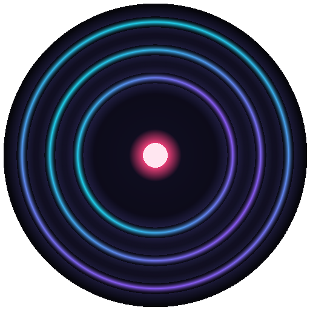

# Infinite Radio

A never-ending, fully local AI radio station. Describe a vibe, press **Tune in**, and
[YuE2](https://huggingface.co/audio-cpp/Yue2-3B-GGUF) (running on
[audio.cpp](https://github.com/0xShug0/audio.cpp)) writes, sings and mixes new
songs back to back while you listen. No cloud APIs, no accounts, no telemetry.



## What it does

- **Infinite playback.** The station keeps a buffer of finished songs ahead of the
  player. When one ends, the next starts. Generation runs continuously in the
  background and the UI shows what is being composed, its phase and an ETA.
- **Your vibe, your lyrics.** Pick a preset or write a style prompt, choose a mood,
  optional lyric themes, target length and vocals mode (auto lyrics, instrumental,
  or only your own requests). A built-in lyric writer runs a small local language
  model (Qwen3 1.7B on llama.cpp) that writes original lyrics in the language you
  choose; an offline template writer is the fallback.
- **Requests.** Paste your own lyrics (with `[Verse]` / `[Chorus]` tags) and the
  station plays them next.
- **Library.** Every song is saved as a 48 kHz stereo WAV. Bookmark, replay, download or
  delete songs from the Library tab.
- **Full-screen player.** Your scene image or loop fills the window (or a live
  visualizer when you have no scene), with the song title in the lower corner. The
  controls fade out after a few seconds of listening and come back when you move the
  mouse, press a key, or tap. Station settings slide in from the left; Up next,
  Library, Episodes and Engine from the right. On a wide screen, pin either panel to
  keep it docked beside the player. Lyrics open as a column over the picture.
- **Keyboard.** Space play/pause, `n` or → skip, `b` bookmark, `s` station,
  `q` up next, `e` episodes, `l` lyrics, `v` scene or visualizer, `f` full screen,
  Esc closes panels.
- **DJ sets.** Press **Start a set** and everything that plays through joins the set;
  skip to cut a song, save the station to open a new section, request a track as a
  guest spot. Close the set, tidy the tracklist, and render it.
- **Episodes.** Any set or library selection becomes a YouTube-ready folder: a 1080p
  MP4 with crossfaded audio, your scene image or loop as the visual, title cards per
  song, a thumbnail PNG, and a description with chapter timestamps.
- **Cross-platform, hardware aware.** The installer picks the right audio.cpp build:
  Apple Metal on macOS, CUDA on NVIDIA (Windows/Linux), Vulkan on other GPUs,
  and CPU as a fallback.

### Honest expectations

YuE2 is a 3B-parameter autoregressive song model. Whether it can out-run playback
depends on your GPU:

| Hardware (published by the audio.cpp authors) | Generation speed |
|---|---|
| RTX 5090, Q8 model | ~5× faster than realtime (195 s of audio in 39 s) |
| RTX 4060 Laptop 8 GB, Q4 model | ~1.8× faster than realtime |
| Apple M1 Max 64 GB (Metal), Q8 model, measured while building this | ~1.4× faster than realtime (90 s song in 62–64 s, model load included) |
| CPU only | much slower than realtime |

Speed is not constant: on the M1 Max, four back-to-back 90 s songs took 62, 64, 93 and
~110 s as the chip warmed up, so a laptop may drift from 1.4× to about 1× realtime
under sustained load. When generation is slower than playback the station still works: it buffers songs
ahead (default 2), shows a "buffering" state between tracks, and the Engine tab
reports the measured realtime factor so you can lower the target length or buffer
more songs. Memory: Q8 peaks around 9 GB of GPU memory, Q4 around 8 GB.

YuE2's weights are licensed **CC BY-NC 4.0** (non-commercial). Songs are
generated audio; lengths are approximate.

### Languages

The lyric model writes about thirty languages. What is known about YuE2 *singing*
them differs, and the Station panel labels each choice accordingly:

| Tier | Languages | Basis |
|---|---|---|
| Evaluated | English, Chinese | the YuE2 paper's benchmark |
| Demo | Japanese, Korean, Spanish, Russian | the official YuE2 demo page |
| Reported | Portuguese, French, Polish, Romanian, Greek, Arabic | user reports on the model card |
| Untested | German, Italian, Dutch, Turkish, Vietnamese, Indonesian, Thai, Hindi, Malay, Swedish, Danish, Finnish, Czech, Filipino, Persian, Hungarian, Cantonese | languages the training transcriber covers; no reports |

The language name is prepended to the style prompt automatically. Score planning is
switched off for non-English lyrics because it has been reported to garble
pronunciation. Your own requests may be in any language.

## Install and run (Pinokio)

In Pinokio, choose **Download from URL** and paste `https://github.com/cocktailpeanut/infinite-radio`.

1. Open the launcher and click **Install**. Choose **Q8** (recommended,
   ~4.5 GB download) or **Q4** (low VRAM, ~3 GB). The installer downloads the
   audio.cpp v0.9.4 release for your platform/GPU, installs the Python web app in a
   virtual environment, and fetches the YuE2 GGUF package from Hugging Face.
2. Click **Start**. The **Open Radio** tab appears once the server is up.
3. Press **Tune in**. The first song takes longer because the model has to load.

Menu items: **Start**, **Songs** (opens the WAV folder), **Update** (pulls the
launcher and refreshes Python deps), **Reinstall** (switch Q8/Q4), **Reset**
(removes binaries, model and venv; keeps your songs and library).

### The lyric writer

`install.js` downloads a llama.cpp build for your platform (Metal on macOS, Vulkan on
Windows/Linux GPUs, CPU otherwise) and the Qwen3 1.7B instruct model at Q4_K_M
(about 1.1 GB). For each song the station runs one short `llama-completion` process
with a JSON-schema grammar that returns five lyric blocks (verse, chorus, verse,
bridge, outro); the app assembles the `[Verse]`/`[Chorus]` sections YuE2 expects and
repeats the chorus itself. When the station's lyric themes are empty, each song gets two random
inspiration words (about 300 concrete nouns in `app/themeseeds.py`, never reused within the
last 20 songs) and the model builds a specific theme around them; small models left to pick a
topic themselves keep returning to the same few. The theme each song used is shown in Now
Playing and stored on the track as `theme`. Outputs are checked for script, length and repetition,
retried once with a higher repeat penalty, and otherwise replaced by the template
writer. Lyric sets are prefetched while the previous song renders, so the song cycle
time is unchanged. Nothing stays resident between calls.

### What gets installed where

```
infinite_radio/
├── app/
│   ├── server.py        # FastAPI web server + JSON API
│   ├── radio.py         # station scheduler, lookahead queue, library
│   ├── engine.py        # supervises audiocpp_server, runs generations
│   ├── lyrics.py        # offline template lyric writer (fallback)
│   ├── lyricwriter.py   # llama.cpp lyric writer (schema-constrained)
│   ├── sets.py          # DJ set state (kept, cut, sections)
│   ├── mixer.py         # crossfade mixer with exact chapter times
│   ├── scene.py         # image/GIF/video -> seamless 1080p loop
│   ├── episodes.py      # render jobs: cards, ffmpeg pass, outputs
│   ├── ambience.py      # ambience pools, on-demand Stable Audio model, bed mixing
│   ├── typo.py          # poster, intro and card typography
│   ├── static/          # dark neon web UI
│   ├── tools/extract_bin.py
│   ├── bin/             # audio.cpp release (downloaded); bin/llama/ holds llama.cpp
│   ├── models/Yue2-3B-GGUF/  # YuE2 GGUF package (downloaded)
│   ├── models/lyrics/   # Qwen3 1.7B GGUF for the lyric writer (downloaded)
│   ├── models/stable-audio-sfx/  # ambience model, only after you opt in (downloaded)
│   ├── output/          # generated WAV files, episodes/<name>/ folders
│   └── data/            # station.json, library.json, server config
├── install.js  start.js  update.js  reset.js  pinokio.js  pinokio.json
└── README.md
```

## Sets, scenes and episodes

**Start a set** from the top bar (or the off-air screen). While it is open, a pill at
the top shows a clock, songs kept and songs cut, and the player shows titles the way
the episode will (numbered, in your chosen title style). Skip turns into a cut button
(scissors, or `n`): it cuts the current song from the set and plays the next; a toast
offers Undo. Saving the station mid-set records a new section so you
can shape an arc from mellow to energetic. **Close set** opens the tracklist: reorder,
remove, rename, choose a crossfade, then **Render episode**.

**Build from library** (Episodes tab) suggests a tracklist from bookmarked or recent
songs for a target length, or use **Select** in the Library to pick songs by hand.

**Scene** is the picture behind the player and every episode. Drop in one file:

| You provide | What happens |
|---|---|
| JPG, PNG, WebP | Slow camera drift, weather (rain, snow, leaves, dust), fog, lamp flicker, grain and vignette are rendered on top as a seamless loop |
| GIF, MP4, WebM, MOV loop | Fitted to 16:9, frame rate normalized, embedded audio dropped, optional ping-pong; grain and vignette available |
| nothing | A mood-colored title card |

**Song titles** on screen (Scene panel, applies to the live stage and to episodes):

| Song titles | Look |
|---|---|
| Minimal (default) | Track number and title in the lower left with a soft shadow, no box |
| Card | Translucent box with "Now playing", number and title |
| None | No titles on screen; the YouTube chapters carry them |

An optional **subtitle** line can show the song's genre, mood or lyric language. It is never
the style prompt: the genre is extracted from the prompt with artist references ("X style",
"like X") and mix notes removed, so "james blake style slow minimal dubstep, heavy sub-bass"
shows as "minimal dubstep". Every subtitle can be edited or cleared per song in the tracklist.
The settings are captured when you press Render, so changing them later does not affect a
queued episode.

Each episode lands in `app/output/episodes/<name>/`:

```
episode.mp4        1080p30 H.264 + AAC, crossfaded mix, intro card, per-song title cards
thumbnail.png      1280x720 frame with the episode title
description.txt    title, chapter timestamps (0:00 first), credits, AI disclosure, license note
tracklist.json     songs with exact start times and durations
```

**Ambience** (Episodes tab) lays a quiet bed of sound under the music, the way
"rainy café jazz" playlists do. Pick a preset (rain on a window, café, subway, vinyl
crackle, night city, fireplace, ocean, forest night), describe your own sound, upload
an audio file, or reuse the sound of your scene video. Level is set in dB under the
music, and "Softer while songs play" ducks it by up to 6 dB so it fills the gaps
between songs and quiet passages. It plays live under the player (also while the
next song is still being generated) and is mixed into rendered episodes with a 4 s
lead-in before the first song and a 6 s fade-out after the last.

Generated ambience uses Stable Audio 3 Small SFX on the same audio.cpp engine. The
model (1.7 GB) is **not** installed up front: the first time you choose a generated
sound, the app shows its size and licence (Stability AI Community License) and
downloads it on your confirmation, resuming if interrupted and verifying its
SHA-256. It can be removed again from the Engine tab. A generated ambience is a
pool of about 10 short takes; uneven takes and tone outliers are dropped, the rest
are matched in loudness, tone and stereo width, and playback chains them in
shuffled order with 3 s crossfades so nothing repeats on a fixed period. Building a
pool takes 20 to 30 seconds and waits for the current song render to finish rather
than slowing it down. Uploads should be your own recordings or CC0 sounds; ambience
copied from other videos can trigger YouTube copyright claims.

Upload is manual: drag `episode.mp4` into YouTube Studio, paste `description.txt`
(YouTube turns the timestamps into chapters when there are at least three), and upload
`thumbnail.png`. There is no YouTube API integration by design.

A 24-second scene loop renders once per scene (about two minutes on an M1 Max) and is
cached. Title cards are fed to ffmpeg as one variable-frame-rate sequence, so encode
speed does not depend on the number of songs: about 3.5× realtime with libx264 and
5 to 6× with a hardware encoder (VideoToolbox, NVENC, AMF or QuickSync, picked
automatically; the **Hardware encoder** toggle in Scene settings turns it off). An
hour-long episode takes roughly 11 to 17 minutes.

## How it works

1. `start.js` launches `python server.py` in the venv. The server picks a free port on
   `127.0.0.1` and prints its URL, which Pinokio captures for the **Open Radio** tab.
2. `engine.py` writes an audio.cpp server config (model directory, selected GGUF
   files, `yue2.mem_saver=true`) and starts `audiocpp_server --no-ui` on another
   free local port with the detected backend. If the process dies it is restarted
   on the next job.
3. `radio.py` runs a worker: while the station is on and fewer than *lookahead*
   songs are ready, it builds a job (auto lyrics, instrumental, or a user request),
   calls `POST /v1/tasks/run` on audio.cpp with the lyrics in `request.text` and the
   style prompt plus sampling options in `request.options`, saves the WAV, and
   appends it to the ready queue. Target length maps to
   `semantic_max_tokens = seconds × 25`.
4. The browser polls `/api/status`, pulls the next song with `/api/next`, streams the
   WAV from `/api/tracks/{id}/audio`, and asks for the next one when playback ends.

## API

Base URL: the address shown in the Pinokio terminal (for example
`http://127.0.0.1:52813`). Interactive docs: `/api/docs`.

| Method | Path | Purpose |
|---|---|---|
| GET | `/api/status` | Station state, settings, ready queue, current job (phase, elapsed, ETA), engine info, stats |
| GET | `/api/station` / PUT `/api/station` | Read / update station settings (`style`, `mood`, `lyric_mode`, `themes`, `language`, `target_seconds`, `planning`, `lookahead`, `quality_steps`) |
| POST | `/api/station/on`, `/api/station/off` | Turn the generator on or off |
| GET | `/api/next` | Pop the next ready song (`track` is `null` while buffering) |
| POST | `/api/requests` | Queue your own lyrics `{lyrics, title?, style?}` |
| DELETE | `/api/requests/{id}` | Remove a pending request |
| GET | `/api/library?liked=1` | All songs, newest first (`liked=1` returns bookmarked songs only) |
| GET | `/api/tracks/{id}` | Song metadata |
| GET | `/api/tracks/{id}/audio?download=1` | WAV audio (add `download=1` for an attachment) |
| POST | `/api/tracks/{id}/like` | Toggle bookmark (stored as the `liked` flag) |
| POST | `/api/tracks/{id}/requeue` | Put a song back at the front of the queue |
| DELETE | `/api/tracks/{id}` | Delete a song and its WAV |
| GET | `/api/presets` | Style presets, moods, and languages with their tier |
| GET | `/api/engine/log`, POST `/api/engine/restart` | audio.cpp log tail / restart |
| POST | `/api/sets/start` `{name}` | Open a DJ set (turns the station on) |
| POST | `/api/sets/cut` `{track_id?}`, `/api/sets/undo`, `/api/sets/close` | Cut the playing song, undo the last cut, close the set |
| GET | `/api/sets`, `/api/sets/current`, `/api/sets/{id}` | List sets, the open set, one set with its tracklist |
| PUT | `/api/sets/{id}` `{name, tracks:[{track_id, display_title, subtitle?}]}` | Reorder, remove or rename kept songs; `subtitle` overrides the on-screen subtitle (`""` hides it) |
| POST | `/api/sets/{id}/render` `{crossfade}` | Render a closed set as an episode |
| POST | `/api/player/ended` `{track_id}` | Tell an open set a song played through (the web player does this) |
| GET | `/api/episodes/suggest?source=bookmarked\|recent&minutes=60&order=chronological\|shuffled` | Suggested tracklist from the library |
| POST | `/api/episodes` `{name, tracks:[{track_id, display_title, subtitle?}], crossfade}` | Render a custom tracklist |
| GET | `/api/episodes`, `/api/episodes/{id}` | Render jobs with status, step and progress |
| GET | `/api/episodes/{id}/file`, `/thumbnail`, `/description` | Outputs (`?download=1` for attachments) |
| POST | `/api/episodes/{id}/cancel`, DELETE `/api/episodes/{id}` | Cancel a render, delete an episode and its files |
| GET | `/api/scene`, PUT `/api/scene` | Scene settings (`camera`, `weather`, `weather_density`, `fog`, `flicker`, `grain`, `vignette`, `pingpong`, `loop_seconds`, `hw_encode`, `title_style` = minimal\|card\|none, `subtitle` = none\|genre\|mood\|language) |
| POST | `/api/scene/upload` (multipart `file`), DELETE `/api/scene`, GET `/api/scene/preview` | Set, clear or view the scene file |
| GET | `/api/ambience` | Ambience settings, current pool and takes, model status and licence, running job, presets |
| PUT | `/api/ambience` `{enabled, level_db, duck}` | Turn ambience on or off, set its level (-36 to -6 dB under the music) and ducking |
| POST | `/api/ambience/generate` `{preset}` or `{prompt}` | Build a generated pool; returns 409 `model_required` with size and licence until the model is installed |
| POST | `/api/ambience/model/download` `{accept_license: true, then_generate?}` | Download the ambience model (resumable), optionally generating right after |
| DELETE | `/api/ambience/model` | Remove the ambience model |
| POST | `/api/ambience/upload` (multipart `file`), `/api/ambience/from-scene` | Build a pool from an audio file or from the scene video's sound |
| POST | `/api/ambience/cancel`, DELETE `/api/ambience` | Cancel the running ambience job; clear the ambience |
| GET | `/api/ambience/pools/{id}/takes/{n}?format=m4a\|wav` | One take of a pool |

### curl

```bash
BASE=http://127.0.0.1:52813   # use the URL from the terminal

# set the vibe and switch the station on
curl -X PUT $BASE/api/station -H 'Content-Type: application/json' \
  -d '{"style":"English, synthwave, retro 80s, glossy synths, breathy female vocal","mood":"dreamy","target_seconds":90}'
curl -X POST $BASE/api/station/on

# queue your own lyrics
curl -X POST $BASE/api/requests -H 'Content-Type: application/json' \
  -d '{"title":"Harbor Lights","lyrics":"[Verse]\nMorning sunlight fills the sky.\n[Chorus]\nSing together, you and I."}'

# render an episode from the two newest songs and poll until it is done
IDS=$(curl -s "$BASE/api/library?limit=2" | jq -c '[.tracks[] | {track_id: .id}]')
JOB=$(curl -s -X POST $BASE/api/episodes -H 'Content-Type: application/json' \
  -d "{\"name\":\"Late Night Mix\",\"tracks\":$IDS,\"crossfade\":2}" | jq -r .id)
until [ "$(curl -s $BASE/api/episodes/$JOB | jq -r .status)" = "done" ]; do sleep 5; done
curl -o episode.mp4 "$BASE/api/episodes/$JOB/file"

# wait for a song, then fetch it
curl $BASE/api/status | jq '.current, .ready[].title'
ID=$(curl -s $BASE/api/next | jq -r '.track.id')
curl -o song.wav "$BASE/api/tracks/$ID/audio"
```

### Python

```python
import requests, time
BASE = "http://127.0.0.1:52813"

requests.put(f"{BASE}/api/station", json={"style": "English, lo-fi soul, Rhodes piano, relaxed male vocal", "mood": "chill"})
requests.post(f"{BASE}/api/station/on")

while True:
    nxt = requests.get(f"{BASE}/api/next").json()
    if nxt["track"]:
        break
    cur = nxt.get("current") or {}
    print("composing", cur.get("title"), "eta", cur.get("eta_seconds"))
    time.sleep(5)

track = nxt["track"]
wav = requests.get(f"{BASE}/api/tracks/{track['id']}/audio").content
open(f"{track['title']}.wav", "wb").write(wav)
print(track["title"], track["duration"], "seconds")
```

### JavaScript

```js
const BASE = "http://127.0.0.1:52813";

await fetch(`${BASE}/api/station`, {
  method: "PUT", headers: { "Content-Type": "application/json" },
  body: JSON.stringify({ style: "English, indie pop, bright acoustic guitar, warm lead vocal", mood: "euphoric" }),
});
await fetch(`${BASE}/api/station/on`, { method: "POST" });

let track = null;
while (!track) {
  const r = await (await fetch(`${BASE}/api/next`)).json();
  track = r.track;
  if (!track) await new Promise((res) => setTimeout(res, 5000));
}
const audio = new Audio(`${BASE}/api/tracks/${track.id}/audio`);
audio.play();
```

## Running without Pinokio

```bash
cd app
python -m venv env && . env/bin/activate      # Windows: env\Scripts\activate
pip install -r requirements.txt
# put an audio.cpp release in app/bin and the YuE2 GGUF package in app/models/Yue2-3B-GGUF
# ffmpeg must be on PATH for episode rendering (Pinokio's environment already provides it)
python tools/extract_bin.py --version v0.9.4
python server.py
```

## Troubleshooting

- **"YuE2 main GGUF not found"**: the model download did not finish. Run
  **Reinstall** from the menu.
- **Lyrics come out in English although another language is selected**: the lyric
  model is missing or failed; the Engine tab's "Lyric writer" line says why. Run
  **Install** again to fetch llama.cpp and the model.
- **Engine state `error` / "audio.cpp server exited"**: check the Engine tab log
  and `logs/api/start.js/latest`. Host RAM pressure is the most common cause on
  16 GB machines; try the Q4 model and a shorter target length.
- **First song never finishes on CPU**: expected to be very slow. Use a GPU build
  or keep target length short.
- **Browser says press play**: autoplay policy. Click the play button once.

## Credits and licenses

- [audio.cpp](https://github.com/0xShug0/audio.cpp) by 0xShug0 and contributors
  (runtime, MIT-licensed; see `app/bin/LICENSE` after install).
- [YuE2](https://huggingface.co/audio-cpp/Yue2-3B-GGUF) by the m-a-p team, GGUF
  packaging by audio-cpp. Weights: CC BY-NC 4.0, non-commercial.
- [Stable Audio 3 Small SFX](https://huggingface.co/stabilityai/stable-audio-3-small-sfx) for generated ambience,
  under the Stability AI Community License (downloaded only when you opt in). Powered by Stability AI.
- [llama.cpp](https://github.com/ggml-org/llama.cpp) (MIT) and
  [Qwen3 1.7B](https://huggingface.co/unsloth/Qwen3-1.7B-GGUF) (Apache 2.0) for the lyric writer.
- Infinite Radio launcher and app: MIT (see `LICENSE`).
